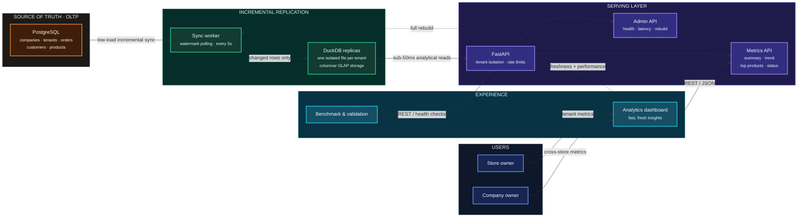

# Multi-Tenant Aggregation Layer: Architecture, Roadmap & Work Split

# CyberForge — System Design



### Design at a glance

| Path | Purpose | Key guarantee |
|---|---|---|
| **Write path** | PostgreSQL → sync worker → DuckDB | Dashboard traffic never hits OLTP |
| **Read path** | Dashboard → FastAPI → DuckDB | Fast, tenant-isolated analytics |
| **Recovery path** | Admin API → sync worker | Rebuild replicas without changing the API |

**Why it scales:** each tenant has an isolated DuckDB replica, so sync and reads stay local to that tenant while company owners can query across their permitted stores through the same API.

## 1. Project Organization & Team Division

| Component | Owner | Scope & Deliverables |
| :--- | :--- | :--- |
| **1. Database Generator & Schema** | Om | - PostgreSQL schema (`tenants`, `customers`, `products`, `orders`, `order_items`).<br>- Synthetic data generator script for 1M (test) and 10M (benchmark) records across 100 tenants.<br>- Realistic non-uniform distribution (e.g. Pareto 80/20 where top 10% tenants generate 80% of orders). |
| **2. Core Aggregation Layer & API** | Sandesh & Antigravity (AI) | - High-performance aggregation engine.<br>- REST API serving dashboard endpoints (FR-1 through FR-7).<br>- Tenant data isolation & security guardrails.<br>- Real-time data sync & update propagation (FR-6).<br>- Bonus capabilities (Freshness headers, Rebuild API, Rate Limiting, Config-driven metrics, Monitor endpoint). |
| **3. Analytics Dashboard Frontend** | Om | - Multi-tenant dashboard UI.<br>- Tenant switcher and date range filters.<br>- Charts: Sales/order count KPI cards, 30-day daily trend, top-10 products, order status donut/bar chart. |
| **4. Benchmark & Validation Harness** | *TBD / Post-MVP* (Deferred) | - *Status: Deferred to after core MVP is working.*<br>- Automated benchmarking suite to evaluate query latency, lag, and database safety when core deliverables are stabilized. |

---

## 2. Crucial Elements Often Missed in Hackathons (Additions to Plan)

To achieve the **"Great"** criteria and convince judges, we must explicitly include:

1. **Automated Correctness & Benchmark Suite:**
   - A script that runs queries against the Aggregator Layer vs direct raw PostgreSQL, validating that numbers match 100% while logging response time comparison (e.g. 15ms vs 4200ms).
   - An OLTP load test measuring write/read TPS on PostgreSQL with vs without dashboard traffic to prove $<10\%$ impact.
2. **Change Capture & Fast Sync Strategy (FR-6 & B-1):**
   - When an order is placed or updated (e.g. `placed` -> `cancelled`), the aggregation layer must update within $<30$ seconds without running heavy scans on Postgres.
3. **One-Command Setup (Docker Compose):**
   - Judges must be able to test the entire system with `docker compose up` without configuring local dependencies.
4. **Resiliency & Self-Healing (B-2):**
   - Full rebuild endpoint (`POST /api/v1/admin/rebuild`) that can reconstruct aggregates from scratch in seconds if the cache/state is cleared.
5. **Config-Driven Metrics (B-4):**
   - A `metrics.yaml` file defining dimensions, aggregations, and filters dynamically.

---

## 3. Technology Stack Selection for Core Aggregator

### Proposed Architecture: Hybrid Pre-computed Aggregates + Fast In-Memory Cache

```
[ PostgreSQL (OLTP) ]
        │
        ├── (1. Low-overhead incremental watermark sync / CDC worker)
        ▼
[ Aggregation Store (DuckDB / Rollup Tables + In-Memory / Redis) ]
        ▲
        │ (2. Sub-20ms reads, strict tenant partitioning)
        │
[ FastAPI / Python Core REST API ]
        ▲
        │ (3. Tenant dashboard requests)
        │
[ Web Dashboard / Frontend & Evaluation Suite ]
```

### Why this stack wins on a laptop:
1. **Python + FastAPI:**
   - Clean async REST API, automatic OpenAPI / Swagger documentation (`/docs`), high developer velocity.
2. **DuckDB / Embedded Columnar Aggregates + Redis / Cache:**
   - DuckDB can query 10 million columnar rows in $<50$ ms on a single laptop without background server overhead or gigabytes of RAM usage.
   - Pre-aggregated rollups (hourly/daily per tenant) stored in summary tables or Redis answer FR-1, FR-2, FR-4 in $<5$ ms.
3. **Incremental Sync Worker:**
   - Polls or listens to PostgreSQL using an `updated_at` index watermark every 5-10 seconds.
   - Fetches only rows modified since the last watermark (`WHERE updated_at > :last_watermark`), ensuring minimal impact on Postgres ($<2\%$ DB load).
   - Keeps data freshness under 10 seconds (well beating the 30-second "Great" threshold).

---

## 4. API Endpoints Plan (FR-1 through FR-7 & Bonuses)

All endpoints enforce tenant isolation via path parameter `/tenants/{tenant_id}/...`.

- `GET /tenants/{tenant_id}/metrics/summary?from=...&to=...` (FR-1: Orders count, total revenue, average order value)
- `GET /tenants/{tenant_id}/metrics/trend?from=...&to=...&interval=day|hour` (FR-2: Daily/hourly trend)
- `GET /tenants/{tenant_id}/metrics/top-products?from=...&to=...&limit=10` (FR-3: Top N products by revenue/quantity)
- `GET /tenants/{tenant_id}/metrics/breakdown/status?from=...&to=...` (FR-4: Orders grouped by status)
- `POST /tenants/{tenant_id}/orders` (Helper/Demo endpoint to trigger live updates)
- `POST /admin/rebuild` (Bonus B-2: Rebuild all aggregates from scratch)
- `GET /admin/health` & `GET /admin/metrics` (Bonus B-1 & B-5: Freshness lag, latency p50/p95/p99, cache hit ratio)
