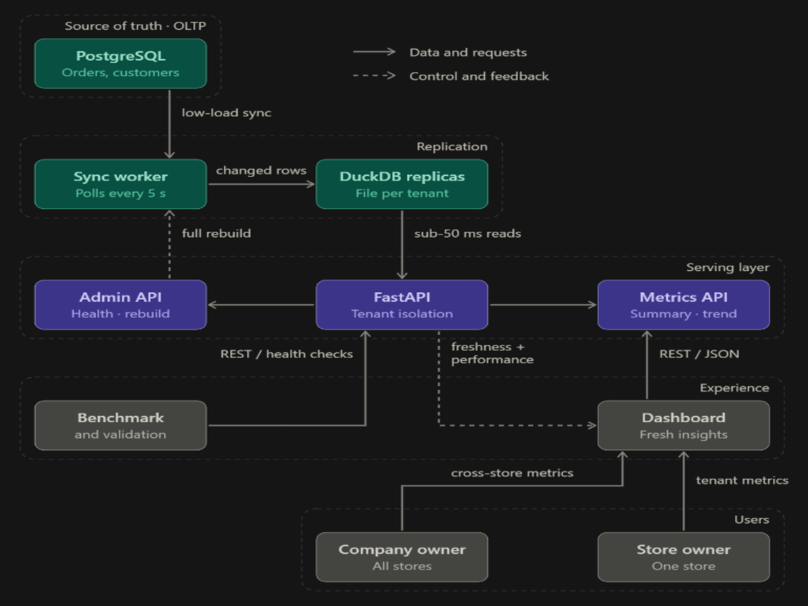

# CyberForge 2026 — Judging Round Draft

## Index

- [1. Problem and Goal](#1-problem-and-goal)
- [2. Our Design](#2-our-design)
  - [Source and storage architecture](#source-and-storage-architecture)
  - [Synchronization](#synchronization)
  - [API paths](#api-paths)
- [3. Functional Requirements Covered](#3-functional-requirements-covered)
- [4. Bonus Features](#4-bonus-features)
- [5. Verified Results](#5-verified-results)
  - [10K live verification](#10k-live-verification)
  - [1M benchmark](#1m-benchmark)
- [6. Problems Encountered and Resolutions](#6-problems-encountered-and-resolutions)
  - [DuckDB ART/index corruption](#duckdb-artindex-corruption)
  - [Appender/resource-in-use failures](#appenderresource-in-use-failures)
  - [Incomplete rollups](#incomplete-rollups)
  - [Readiness with incomplete data](#readiness-with-incomplete-data)
  - [Freshness test timestamp ordering](#freshness-test-timestamp-ordering)
  - [Deletes and stale replicas](#deletes-and-stale-replicas)
  - [Windows file locking](#windows-file-locking)
- [7. Trade-offs](#7-trade-offs)
- [8. Cybersecurity and Privacy Considerations](#8-cybersecurity-and-privacy-considerations)
- [9. What We Deliver](#9-what-we-deliver)
- [10. Reproduction Steps](#10-reproduction-steps)
  - [Prerequisites](#prerequisites)
  - [Database migration](#database-migration)
  - [Generate and distribute 10K data](#generate-and-distribute-10k-data)
  - [Start the server](#start-the-server)
  - [Run the real HTTP verification](#run-the-real-http-verification)
  - [Run TestClient verification](#run-testclient-verification)
- [11. Run Results](#11-run-results)

## 1. Problem and Goal

The project is a multi-tenant aggregation layer for dashboards. Each store is a
tenant, and a company owner may own many stores. The system must provide fast,
fresh, correct analytics without sending heavy dashboard queries to the
transactional database.

The PRD targets are:

- Fast dashboard responses.
- Fresh results after new or updated orders.
- Strict tenant separation.
- Correct results compared with the source database.
- Safe scaling as the data volume grows.
- A simple REST API; a polished UI is not required.

## 2. Our Design

### Source and storage architecture



PostgreSQL remains the source of truth. Dashboard reads are served from
tenant-isolated DuckDB replicas. Hourly rollups contain aggregate values such
as counts and revenue, not customer PII.

### Synchronization

- Initial loads use batched keyset pagination.
- Replicas are built in staging files and promoted atomically only after
  validation.
- Incremental sync uses a composite `(updated_at, id)` watermark.
- Changed orders and order items are upserted.
- Only affected hourly buckets are refreshed during incremental updates.
- Up to four independent tenants can synchronize concurrently.
- Every tenant has its own lock, so one tenant's write does not corrupt or
  block another tenant's DuckDB file.
- The API becomes ready only after all tenant replicas pass validation.

### API paths

- Tenant dashboard:
  `GET /tenants/{tenant_id}/metrics/...`
- Company-owner dashboard:
  `GET /companies/{company_id}/metrics/...`
- Health:
  `GET /admin/health`
- Diagnostics:
  `GET /admin/metrics`
- Rebuild:
  `POST /admin/rebuild`
- OpenAPI documentation:
  `GET /docs`

## 3. Functional Requirements Covered

| Requirement | What we implemented | Verification |
|---|---|---|
| FR-1 | Summary counts, revenue, and average order value | Company API compared with all owned tenant PostgreSQL databases |
| FR-2 | Daily/hourly trend aggregation | Every returned bucket compared with PostgreSQL |
| FR-3 | Top-N product aggregation | Revenue and product ranking compared with PostgreSQL |
| FR-4 | Status breakdown and revenue | All status totals compared with PostgreSQL |
| FR-5 | Physical tenant isolation | Dedicated PostgreSQL and DuckDB files, tenant-scoped API access |
| FR-6 | New order propagation | Freshness test inserts an order and verifies its exact replica presence |
| FR-7 | REST API and OpenAPI documentation | FastAPI routes and `/docs` |

## 4. Bonus Features

| Bonus | Implementation |
|---|---|
| B-1 | Freshness metadata such as `data_freshness_seconds` |
| B-2 | Atomic full rebuild and `POST /admin/rebuild` |
| B-3 | Tenant/company rate limiting |
| B-4 | Config-driven metrics from `config/metrics.yaml` |
| B-5 | Health and rolling latency diagnostics through `/admin/metrics` |

## 5. Verified Results

### 10K live verification

The current verified development run uses 10,000 orders across 10 tenants.
The real-network command reached the running Uvicorn service and verified:

- Company ownership resolved all 10 stores.
- FR-1 summary matched PostgreSQL: 10,000 orders and
  `$5,258,913.21` in the earlier verified run.
- FR-2 daily trend matched PostgreSQL across all returned days.
- FR-3 top products matched PostgreSQL.
- FR-4 status counts and revenue matched PostgreSQL.
- Store drill-down matched Tenant 1 PostgreSQL.
- Query responses were below the 200 ms target in the recorded run.
- FR-6 was strengthened to verify order count, revenue delta, and exact order
  presence in the tenant replica.

During live verification, FR-5, B-4, and B-5 can be intentionally omitted with
`--live2` because Windows prevents a second process from opening the live
DuckDB files with a different connection configuration.

### 1M benchmark

The verified real-network run used 1,000,000 orders across 10 tenants. It
passed all reported verification phases and compared API results with the
PostgreSQL source databases.

- Total records: `1,000,000`
- Tenants: `10`
- DuckDB replica count: `1,000,000`
- PostgreSQL estimated count: `1,000,000`
- FR-1 summary: `4.02 ms`, exact match, revenue `$522,985,344.15`
- FR-2 daily trend: `10.72 ms`, exact match across 62 days
- FR-3 top products: `35.14 ms`, top-product value exact match
- FR-4 status breakdown: `17.73 ms`, exact match across all 4 statuses
- Tenant 1 drill-down: `3.27 ms`, `389,376` orders, exact match with
  `cyberforge_tenant_1`
- FR-6/B-1 freshness: `5.03 seconds`
- Performance target: all measured queries were below `200 ms`
- Freshness target: `5.03 seconds`, below the `30 second` target
- Overall result: `ALL 10 VERIFICATION PHASES PASSED`

The command used was:

```powershell
python3 scripts/test_aggregator.py --network http://127.0.0.1:8000 --live2
```

The `--live2` mode intentionally skips the checks that require a second
process to inspect server-owned DuckDB files or optional diagnostic
configuration. The live HTTP path, source comparisons, company aggregation,
tenant drill-down, and freshness check still ran.


## 6. Problems Encountered and Resolutions

### DuckDB ART/index corruption

An earlier replica load produced an ART corruption error. PostgreSQL diagnostics
showed that the source IDs were not duplicated. We replaced the unsafe write
lifecycle with transactional batch writes, staging replicas, validation, and
atomic promotion.

### Appender/resource-in-use failures

The previous Appender lifecycle could leave a file or write operation in an
unsafe state. Appender writes were replaced with safer batch upserts and
explicit connection/transaction handling.

### Incomplete rollups

Replicas could contain raw rows while rollups were incomplete. Validation now
checks source counts, replica counts, order-item counts, and rollup totals.
Invalid replicas are rebuilt before the API is ready.

### Readiness with incomplete data

The API previously had a timeout fallback. That was removed. The API remains
unavailable until all tenants are validated.

### Freshness test timestamp ordering

Generated data contained future `updated_at` values. A test order with an older
timestamp was correctly skipped by the watermark query. FR-6 now inserts the
test order strictly after the current source maximum timestamp and verifies the
specific order ID.

### Deletes and stale replicas

The current incremental path is optimized for inserts and updates. A source
delete can leave a stale replica row until validation/rebuild. A production
extension would use tombstones, CDC, or an outbox/change log for deletions.

### Windows file locking

The live API owns its DuckDB files. A second process cannot reliably open those
files for direct inspection. Live tests therefore use API-level checks, while
offline isolation inspection is kept separate.

## 7. Trade-offs

- DuckDB replicas add storage and synchronization complexity, but protect the
  OLTP database from dashboard scans.
- Per-tenant files provide stronger physical isolation, but require managing
  many files and connections.
- Precomputed hourly rollups improve latency, but arbitrary partial-hour ranges
  require additional raw-order handling for exact boundary semantics.
- Atomic rebuilds prevent a failed load from damaging a live replica, but a
  rebuild temporarily uses additional disk space.
- Bounded parallelism improves throughput, but is deliberately limited to
  avoid exhausting PostgreSQL connections and DuckDB resources.
- The current deletion path is less complete than the insert/update path; CDC
  or tombstones are the next production-hardening step.
- No UI is included yet. The REST API is complete and can be called from
  Postman, a frontend, a notebook, or any HTTP client.

## 8. Cybersecurity and Privacy Considerations

- Tenant data is physically separated into dedicated source databases and
  dedicated DuckDB files.
- Company APIs resolve ownership before aggregating stores.
- Foreign-store access is rejected.
- Every tenant query is scoped to the requested tenant.
- Dashboard reads do not run against the transactional PostgreSQL workload.
- Hourly rollups are aggregate-only and do not store customer PII.
- Rate limiting reduces abusive heavy-query traffic.
- Readiness validation prevents serving incomplete or inconsistent replicas.
- Atomic replacement reduces the risk of exposing partially written data.
- The remaining production security work includes authentication,
  authorization integration, secret management, TLS, and audit logging.

## 9. What We Deliver

The current deliverable is a working REST aggregation service with:

- Dedicated tenant PostgreSQL source databases.
- Dedicated tenant DuckDB analytics replicas.
- Background synchronization and rollups.
- Company-owner aggregation endpoints.
- Tenant drill-down endpoints.
- Health, rebuild, rate-limit, and diagnostic APIs.
- OpenAPI/Swagger documentation.
- Verification and benchmarking scripts.

A dashboard UI is not included because it is not required by the PRD.

## 10. Reproduction Steps

### Prerequisites

1. Clone the repository.
2. Create and activate a Python virtual environment.
3. Install dependencies:

   ```powershell
   .\.venv\Scripts\python.exe -m pip install -r requirements.txt
   ```

4. Install and start PostgreSQL.
5. Create/configure the PostgreSQL credentials in `.env`, including:
   `DB_NAME`, `DB_USER`, `DB_PASSWORD`, `DB_HOST`, and `DB_PORT`.
6. Ensure the configured PostgreSQL user can create the dedicated tenant
   databases.

### Database migration

From the repository root:

```powershell
.\.venv\Scripts\alembic.exe upgrade head
```

### Generate and distribute 10K data

The number of tenants and orders can be changed as required:

```powershell
.\.venv\Scripts\python.exe scripts\generate_data.py --tenants 10 --orders 10000
.\.venv\Scripts\python.exe scripts\setup_tenant_databases.py
```

### Start the server

In Terminal A:

```powershell
.\.venv\Scripts\python.exe run_aggregator.py
```

Wait until the logs show that the API is ready.

### Run the real HTTP verification

In Terminal B:

```powershell
.\.venv\Scripts\python.exe scripts\test_aggregator.py --network http://127.0.0.1:8000 --live2
```

`--live2` skips the optional B-4, FR-5, and B-5 checks during live Windows
verification. FR-1 through FR-4, the tenant drill-down, and FR-6 continue.

### Run TestClient verification

Stop the Uvicorn server, then run:

```powershell
.\.venv\Scripts\python.exe scripts\test_aggregator.py --live2
```

This uses FastAPI TestClient in-process, while still using the real PostgreSQL,
DuckDB, synchronization worker, and API handlers.

## 11. Run Results

Paste the final judge-facing outputs below after the current 1M and 10M runs:


[PASTE FINAL 1M BENCHMARK OUTPUT HERE]
| Test | Result | Latency / Evidence | Status |
|---|---|---|---|
| Dataset | 1,000,000 orders across 10 tenants | DuckDB: 1,000,000; PostgreSQL estimate: 1,000,000 | ✅ Passed |
| FR-1: Company Summary | 1,000,000 orders; revenue $522,985,344.15 | 4.02 ms; exact PostgreSQL match | ✅ Passed |
| FR-2: Daily Trends | 62 daily buckets | 10.72 ms; exact match across all days | ✅ Passed |
| FR-3: Top-10 Products | Top product revenue matched PostgreSQL | 35.14 ms | ✅ Passed |
| FR-4: Status Breakdown | All 4 statuses matched PostgreSQL | 17.73 ms | ✅ Passed |
| Tenant Drill-down | Tenant 1: 389,376 orders | 3.27 ms; exact PostgreSQL match | ✅ Passed |
| FR-6/B-1: Freshness | New order appeared in company and tenant APIs | 5.03 seconds | ✅ Passed |
| Query Performance | All measured queries below target | Target: <200 ms | ✅ Passed |
| Data Freshness | New data visible below target | Target: <30 seconds | ✅ Passed |
| **Overall** | **All reported verification phases passed** | **Real HTTP through Uvicorn** | **✅ Passed** |

Raw test run result : 

```


ompatil@OMs-MacBook-Air CyberForge2026 %  source /Users/ompatil/Desktop/CyberForge2026/.venv/bin/activate
(.venv) ompatil@OMs-MacBook-Air CyberForge2026 % python3 scripts/test_aggregator.py --network http://127.0.0.1:8000 --live2
============================================================================
  CYBERFORGE MULTI-TENANT AGGREGATION LAYER — OFFICIAL VERIFICATION SUITE
  Scope: 1 Company Owner, 10 Stores / Tenants, source-count validated
  Performance Target: < 200 ms query latency | < 30 s data freshness
============================================================================

1. Testing Cluster Health & API Readiness...
2026-11-01 08:21:02  INFO      httpx — HTTP Request: GET http://127.0.0.1:8000/ "HTTP/1.1 200 OK"
   -> API Status     : CyberForge Aggregation API v1.0.0 (200 OK)
2026-11-01 08:21:02  INFO      httpx — HTTP Request: GET http://127.0.0.1:8000/admin/health "HTTP/1.1 200 OK"
   -> DuckDB Synced  : 1,000,000 orders across all store replicas
   -> PostgreSQL Est.: 1,000,000 orders across 10 tenant databases

2. Testing FR-1: Company Owner Summary (All 10 Stores)...
2026-11-01 08:21:02  INFO      httpx — HTTP Request: GET http://127.0.0.1:8000/companies/1/metrics/summary?from_date=2026-01-01T00:00:00&to_date=2026-12-31T23:59:59 "HTTP/1.1 200 OK"
2026-11-01 08:21:02  INFO      httpx — HTTP Request: GET http://127.0.0.1:8000/companies/1/metrics/summary?from_date=2026-01-01T00:00:00&to_date=2026-12-31T23:59:59 "HTTP/1.1 200 OK"
   -> Latency        : 4.02 ms  [Target: < 200 ms] -> [GREAT] (< 200 ms)
   -> Stores Owned   : 10 stores ([1, 2, 3, 4, 5, 6, 7, 8, 9, 10])
   -> Combined Orders: 1,000,000 orders
   -> Total Revenue  : $522,985,344.15
   -> Avg Order Value: $522.99
   -> Correctness    : EXACT MATCH (orders=1,000,000, revenue=$522,985,344.15)

3. Testing FR-2: Company Owner Daily Trend (Aggregated Across All 10 Stores)...
2026-11-01 08:21:02  INFO      httpx — HTTP Request: GET http://127.0.0.1:8000/companies/1/metrics/trend?interval=day&from_date=2026-01-01T00:00:00%2B00:00&to_date=2026-12-31T23:59:59%2B00:00 "HTTP/1.1 200 OK"
2026-11-01 08:21:02  INFO      httpx — HTTP Request: GET http://127.0.0.1:8000/companies/1/metrics/trend?interval=day&from_date=2026-01-01T00:00:00%2B00:00&to_date=2026-12-31T23:59:59%2B00:00 "HTTP/1.1 200 OK"
   -> Latency        : 10.72 ms  [Target: < 200 ms] -> [GREAT] (< 200 ms)
   -> Daily Buckets  : 62 days returned
   -> Correctness    : EXACT MATCH across all 62 days vs PostgreSQL
   -> Latest Day     : 2026-11-02 -> 444 orders ($242,195.86)

4. Testing FR-3: Company Owner Top-10 Products (Across Entire Store Network)...
2026-11-01 08:21:02  INFO      httpx — HTTP Request: GET http://127.0.0.1:8000/companies/1/metrics/top-products?limit=10&from_date=2026-01-01T00:00:00%2B00:00&to_date=2026-12-31T23:59:59%2B00:00 "HTTP/1.1 200OK"
   -> Latency        : 35.14 ms  [Target: < 200 ms]
   -> Correctness    : Top product 'Stainless Steel Toaster #1' API=46,844,736.85vsPG=46,844,736.85 -> MATCH
   -> #1 [Home & Kitchen] Stainless Steel Toaster #1 — 183,023 sold ($46,844,736.85)
   -> #2 [Sports & Outdoors] Weatherproof Resistance Bands #2 — 102,113 sold ($25,249,481.51)
   -> #3 [Sports & Outdoors] Performance Water Bottle #1 — 52,196 sold ($18,986,295.00)
   -> #4 [Apparel] Thermal Cap #5 — 46,828 sold ($17,382,085.32)
   -> #5 [Apparel] Casual Socks #3 — 70,999 sold ($12,997,076.94)

5. Testing FR-4: Company Owner Status Breakdown...
2026-11-01 08:21:02  INFO      httpx — HTTP Request: GET http://127.0.0.1:8000/companies/1/metrics/breakdown/status?from_date=2026-01-01T00:00:00%2B00:00&to_date=2026-12-31T23:59:59%2B00:00 "HTTP/1.1 200 OK"
   -> Latency        : 17.73 ms  [Target: < 200 ms]
   -> delivered   : 649,991 orders ( 65.0%) $340,392,479.54  MATCH
   -> shipped     : 180,309 orders ( 18.0%) $93,992,662.65  MATCH
   -> placed      :  99,920 orders ( 10.0%) $52,121,553.00  MATCH
   -> cancelled   :  69,780 orders (  7.0%) $36,478,648.96  MATCH
   -> Correctness    : EXACT MATCH across all 4 statuses vs PostgreSQL

7. Testing Store #1 Individual Drill-Down...
2026-11-01 08:21:02  INFO      httpx — HTTP Request: GET http://127.0.0.1:8000/tenants/1/metrics/summary?from_date=2026-01-01T00:00:00&to_date=2026-12-31T23:59:59 "HTTP/1.1 200 OK"
   -> Store #1 Summary Latency : 3.27 ms
   -> Store #1 Orders          : 389,376 orders
   -> Correctness    : DuckDB=389,376 vs tenant_1 PG=389,376 -> MATCH

10. Testing FR-6 & B-1: End-to-End Freshness Latency Benchmark...
2026-11-01 08:21:03  INFO      httpx — HTTP Request: GET http://127.0.0.1:8000/companies/1/metrics/summary?from_date=2020-01-01T00%3A00%3A00%2B00%3A00&to_date=2100-01-01T00%3A00%3A00%2B00%3A00 "HTTP/1.1 200 OK"
   -> Injecting new live order into Store #1 in PostgreSQL (central & tenant DBs)...
   -> Polling Company Owner dashboard for real-time reflection...
2026-11-01 08:21:08  INFO      httpx — HTTP Request: GET http://127.0.0.1:8000/companies/1/metrics/summary?from_date=2020-01-01T00%3A00%3A00%2B00%3A00&to_date=2100-01-01T00%3A00%3A00%2B00%3A00 "HTTP/1.1 200 OK"
2026-11-01 08:21:08  INFO      httpx — HTTP Request: GET http://127.0.0.1:8000/tenants/1/metrics/order-presence/99999999 "HTTP/1.1 200 OK"
   -> Measured Order Freshness: 5.03 seconds

============================================================================
  ALL 10 VERIFICATION PHASES PASSED! ALL HACKATHON BENCHMARKS SATISFIED!
===========================================================================


```
